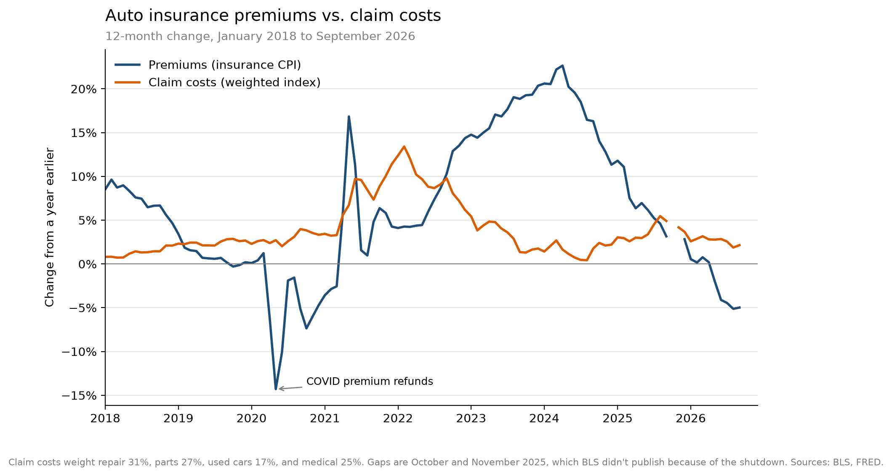
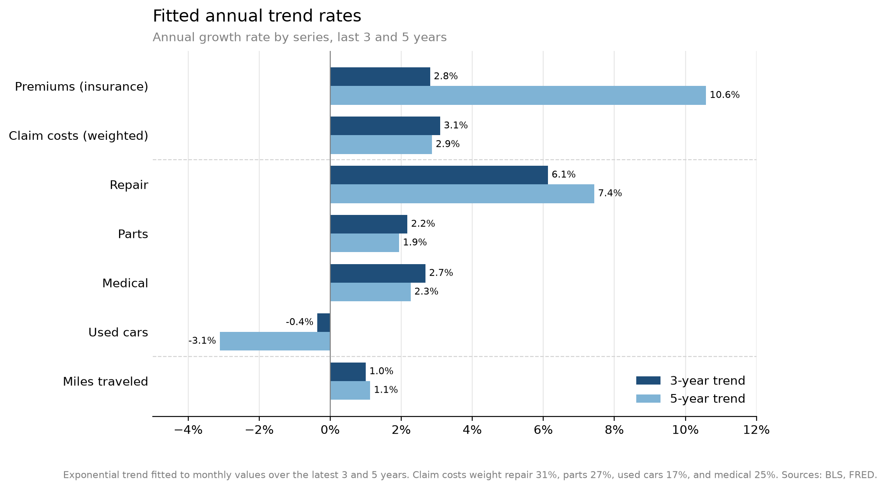
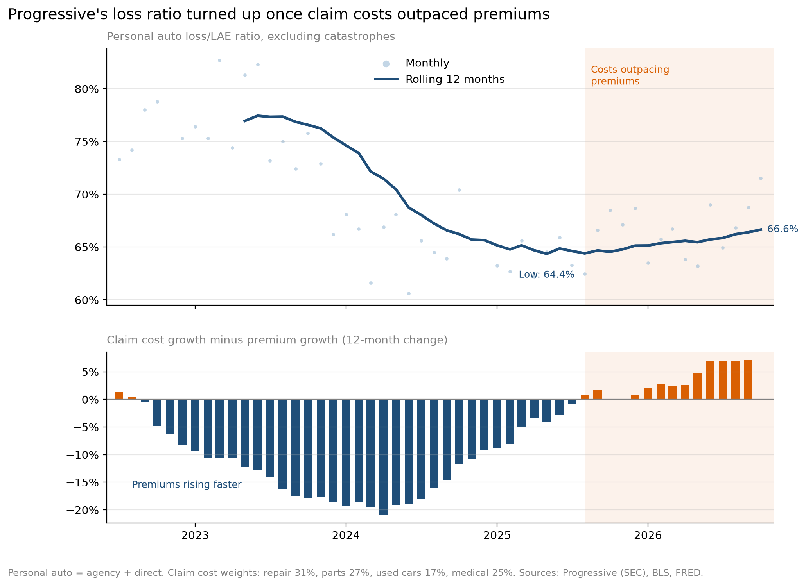

<a href="https://shaneghim.github.io/" style="display:inline-block;padding:4px 12px;border:1px solid #d6dbe1;border-radius:999px;font-family:Helvetica,Arial,sans-serif;font-size:0.85rem;color:#1f4e79;text-decoration:none;background:#fff;">&larr; All projects</a>

# Auto Insurance Loss Trend Monitor: Are Premiums Keeping Up with Claim Costs?

This project tracks whether auto insurance premiums are keeping pace with the costs that drive claims. A Python pipeline pulls monthly government price data and Progressive's monthly results, stores them in a SQLite database, fits 3-year and 5-year trend rates, and updates the charts and an Excel summary on its own every month through GitHub Actions.

The numbers in our data below are as of the November 2026 update (CPI through September 2026, Progressive through October 2026).
[Download the Excel workbook](https://github.com/shaneghim/autolosstrend/raw/main/autolosstrend.xlsx)

You can see every run in the [workflow history](https://github.com/shaneghim/autolosstrend/actions/workflows/monthly_update.yml), and each update is saved as a "Monthly data update" commit.

**Data**

- **Claim cost drivers:** CPI for motor vehicle repair, motor vehicle parts, used cars and trucks, and medical care, from [FRED](https://fred.stlouisfed.org/series/CUSR0000SETD).
- **Premiums:** CPI for motor vehicle insurance. FRED doesn't carry it, so I needed to pull it directly from the [BLS API](https://beta.bls.gov/dataViewer/view/timeseries/CUSR0000SETE).
- **Exposure:** vehicle miles traveled, from the Department of Transportation through FRED.
- **Insurer results:** Progressive's monthly personal auto results from its 8-K filings on [SEC EDGAR](https://www.sec.gov/cgi-bin/browse-edgar?action=getcompany&CIK=0000080661&type=8-K), from July 2022 onward.

All CPI series are seasonally adjusted. BLS didn't collect October 2025 prices during the government shutdown, and the insurance series has no row at all for November 2025, so 12-month changes match on the date one year earlier instead of counting rows back.

<ins>Terminology</ins>

Seasonally adjusted: monthly data with the usual calendar patterns removed (like more driving every summer), so one month can be compared fairly with the month before.

Severity: the average cost per claim.

Trend rate: the steady annual growth rate that best fits the monthly values over a window, from an exponential fit.

Trend factor: how much higher costs will be over a set period, (1 + trend rate) ^ years.

Loss/LAE ratio: claims paid plus claim handling costs (loss adjustment expense), divided by premiums earned.

**Method**

<ins>Trend rates</ins>

I calculated 12-month changes in SQL with a self-join on the date one year earlier. Counting 12 rows back would compare against the wrong month after a missing row, so matching on the actual date keeps every comparison exactly one year apart. I then fit exponential trends (a straight line through the logged monthly values) over the latest 3 and 5 years for each series.

<ins>Claim cost index</ins>

To compare claim costs with premiums directly, I needed one claim cost number, not four, so I combined the cost drivers into a single claim cost (severity) trend. Using public figures on injury claims ([LexisNexis and Verisk/CCC](https://actuary.info/insights/auto-bodily-injury-payouts-cross-physical-damage-2026)), total losses ([CCC](https://www.repairerdrivennews.com/2026/10/19/ccc-mid-year-collision-repair-trends-update-show-more-expensive-claims-total-losses/)), and parts' share of repair costs ([Mitchell](https://www.mitchell.com/insights/article/auto-physical-damage/mitchell-collision-repair-industry-data-q1-2018)), I weighted them by their rough share of claim dollars: repair 31%, parts 27%, used cars 17%, and medical 25%. Since the weights are approximate, I tested three alternative weightings.

<ins>Trend factors</ins>

I projected from the middle of the latest 12 months (April 1, 2026) to the average claim date for 12-month policies written starting July 1, 2027 (July 1, 2028), a 2.25-year trend period. The latest 12 months of costs are spread across the year, so their midpoint stands for the average date of that data, and trending from there to the average claim date shows how much costs will grow before the claims new rates have to cover.

<ins>Progressive</ins>

To see whether these trends show up in an actual insurer's results, I compared them with Progressive, one of the few large auto insurers that reports results every month. Personal auto combines Progressive's agency and direct channels, weighted by premiums earned. Progressive changed its table layout around the start of 2025, so the parser handles both versions. I used the loss/LAE ratio excluding catastrophes, smoothed over rolling 12 months.

**Results**

| Window | Claim cost trend | Premium trend | Gap | Claim cost factor | Premium factor |
|---|---:|---:|---:|---:|---:|
| 3 years | 3.1% | 2.8% | -0.3 pts | 1.071 | 1.064 |
| 5 years | 2.9% | 10.6% | +7.7 pts | 1.066 | 1.254 |

**Findings**

Over 5 years, premiums grew 10.6% a year against 2.9% for claim costs, as insurers caught up after the 2021 and 2022 cost spike. Premium growth peaked at 22.6% in April 2024. Over 3 years, the two have roughly kept pace: the gap stays within 0.3 points of zero across all four weightings and turns positive when total losses get more weight.

The past year looks different. As of September 2026, premiums were down 5.0% from a year earlier while repair costs rose 5.8% and medical 1.5%, and claim costs have grown faster than premiums every month since August 2025.

Progressive's results follow the same cycle. Its 12-month personal auto loss ratio excluding catastrophes fell from about 77% in 2023 to a low of 64.4% in May 2025 while premiums outran costs. After costs began outpacing premiums, it rose to 66.6% by October 2026, and the October monthly ratio reached 71.5%.

**Automation and Excel**

On the 22nd of every month, GitHub Actions runs `scripts/update.py`, which pulls the latest data, recalculates every table, redraws the charts, and saves the results back to this repo. The Excel workbook (`autolosstrend.xlsx`) reads the CSVs in `exports/` through Power Query and refreshes when it opens, with a summary sheet built on XLOOKUP and FILTER.

**Files**

- `notebooks/1_fred_pull.ipynb`: pulls the FRED and BLS series, checks for missing months, saves to SQLite
- `notebooks/2_trend_rates.ipynb`: 12-month changes, fitted trend rates, claim cost index, sensitivity test, trend factors
- `notebooks/3_charts.ipynb`: premiums vs. claim costs and trend rate charts
- `notebooks/4_progressive.ipynb`: parses Progressive's SEC filings and compares its loss ratio with the cost-premium gap
- `scripts/update.py`: the full monthly pipeline
- `.github/workflows/monthly_update.yml`: the monthly schedule
- `data/trend.db`: SQLite database with every table
- `exports/`: CSVs for Excel
- `images/`: charts used on this page
- `autolosstrend.xlsx`: Excel summary

<ins>To rerun it</ins>

1. Get free API keys from [FRED](https://fredaccount.stlouisfed.org) and [BLS](https://data.bls.gov/registrationEngine/), and save them in a `.env` file as `FRED_API_KEY` and `BLS_API_KEY`, along with `SEC_USER_AGENT` (your name and email, which the SEC requires).
2. Create a Python 3.13 environment and install the packages: `uv venv --python 3.13`, then `uv pip install -r requirements.txt`.
3. Run `python scripts/update.py`, or run the notebooks in order.

**What's next**

I could add incurred loss data or a second insurer that reports monthly, and compare the 2.25-year trend factors with the rate changes insurers actually file with state regulators.

**Limitations**

This project uses public stand-ins, not the data an actuary would use to select trend: that takes an insurer's own claim counts, losses, and exposures, which aren't public. CPI tracks consumer prices rather than claim costs, and the claim cost weights are approximate. Progressive is one insurer whose loss ratio also reflects its own pricing, customer mix, and reserves, so the comparison shows an association, not a cause.
